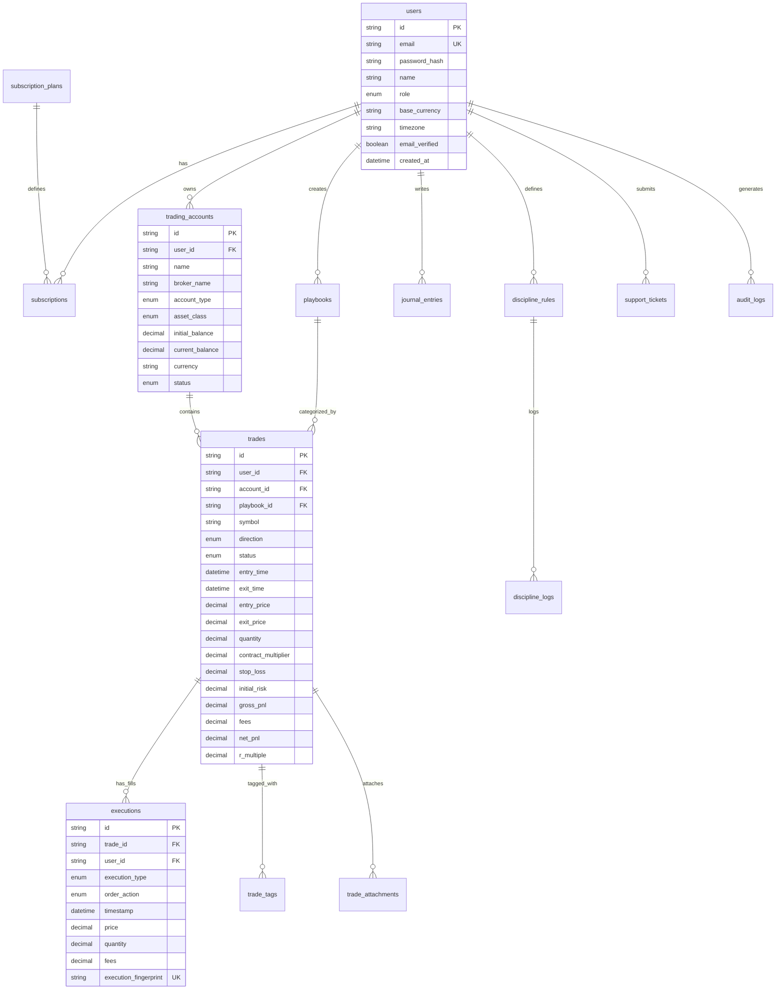

# Database Schema: TradePulse SaaS
**Multi-Tenant Relational Schema & Data Integrity Specification**

---

## 1. Schema Design Overview

The database is built on **PostgreSQL 16+** using **Prisma ORM**. It is structured for strict multi-tenant isolation, ACID compliance for financial computations, and high-performance querying on time-series trade records.

### Core Integrity Guarantees
- Every tenant resource maintains a foreign key to `users(id)`.
- Cascading deletes ensure clean tenant removal upon GDPR account deletion.
- Composite unique constraints prevent duplicate execution entries during broker CSV imports.
- Numeric quantities, prices, fees, and P&L use high-precision decimals (`Decimal(16, 4)` / `Decimal(12, 2)`) to eliminate floating-point rounding errors.

---

## 2. Entity Relationship Diagram (Mermaid)



---

## 3. Detailed Table Definitions (Prisma Schema Model)

```prisma
datasource db {
  provider = "postgresql"
  url      = env("DATABASE_URL")
}

generator client {
  provider = "prisma-client-js"
}

enum Role {
  USER
  ADMIN
}

enum AccountType {
  CASH
  MARGIN
  PROP_EVALUATION
  PROP_FUNDED
  DEMO
}

enum AssetClass {
  STOCKS
  FUTURES
  FOREX
  CRYPTO
  OPTIONS
  CFDS
}

enum AccountStatus {
  ACTIVE
  ARCHIVED
  BREACHED
}

enum TradeDirection {
  LONG
  SHORT
}

enum TradeStatus {
  OPEN
  CLOSED
}

enum ExecutionType {
  ENTRY
  EXIT
}

enum OrderAction {
  BUY
  SELL
}

enum TagType {
  MISTAKE
  SETUP
  MARKET_CONDITION
  CUSTOM
}

enum SubscriptionStatus {
  ACTIVE
  TRIALING
  PAST_DUE
  CANCELED
  INCOMPLETE
}

enum TicketStatus {
  OPEN
  IN_PROGRESS
  RESOLVED
  CLOSED
}

model User {
  id              String        @id @default(uuid())
  email           String        @unique
  passwordHash    String?
  name            String
  avatarUrl       String?
  role            Role          @default(USER)
  baseCurrency    String        @default("USD")
  timezone        String        @default("America/New_York")
  emailVerified   Boolean       @default(false)
  verificationToken String?
  resetToken      String?
  resetTokenExpiry DateTime?
  createdAt       DateTime      @default(now())
  updatedAt       DateTime      @updatedAt

  subscription    Subscription?
  accounts        TradingAccount[]
  playbooks       Playbook[]
  trades          Trade[]
  executions      Execution[]
  journalEntries  JournalEntry[]
  disciplineRules DisciplineRule[]
  disciplineLogs  DisciplineLog[]
  supportTickets  SupportTicket[]
  auditLogs       AuditLog[]

  @@map("users")
}

model SubscriptionPlan {
  id                  String         @id @default(uuid())
  name                String         // "Starter", "Pro", "Elite"
  slug                String         @unique // "starter", "pro", "elite"
  priceMonthly        Decimal        @db.Decimal(10, 2)
  priceYearly         Decimal        @db.Decimal(10, 2)
  maxAccounts         Int            @default(2)
  maxTradesPerMonth   Int            @default(100) // -1 for unlimited
  hasCsvImport        Boolean        @default(false)
  hasAdvancedAnalytics Boolean       @default(false)
  hasPlaybooks        Boolean        @default(false)
  hasAiMentor         Boolean        @default(false)
  hasReplay           Boolean        @default(false)
  stripeMonthlyPriceId String?
  stripeYearlyPriceId  String?
  isActive            Boolean        @default(true)
  createdAt           DateTime       @default(now())
  updatedAt           DateTime       @updatedAt

  subscriptions       Subscription[]

  @@map("subscription_plans")
}

model Subscription {
  id                   String             @id @default(uuid())
  userId               String             @unique
  planId               String
  stripeCustomerId     String?            @unique
  stripeSubscriptionId String?            @unique
  status               SubscriptionStatus @default(TRIALING)
  currentPeriodStart   DateTime?
  currentPeriodEnd     DateTime?
  cancelAtPeriodEnd    Boolean            @default(false)
  createdAt            DateTime           @default(now())
  updatedAt            DateTime           @updatedAt

  user                 User               @relation(fields: [userId], references: [id], onDelete: Cascade)
  plan                 SubscriptionPlan   @relation(fields: [planId], references: [id])

  @@map("subscriptions")
}

model WebhookEvent {
  id           String    @id @default(uuid())
  eventId      String    @unique
  provider     String    // "stripe" or "lemonsqueezy"
  eventType    String
  payload      Json
  status       String    @default("PROCESSED") // PROCESSED, FAILED
  errorMessage String?
  createdAt    DateTime  @default(now())

  @@map("webhook_events")
}

model TradingAccount {
  id             String         @id @default(uuid())
  userId         String
  name           String
  brokerName     String
  accountType    AccountType    @default(CASH)
  assetClass     AssetClass     @default(STOCKS)
  initialBalance Decimal        @db.Decimal(16, 2)
  currentBalance Decimal        @db.Decimal(16, 2)
  currency       String         @default("USD")
  status         AccountStatus  @default(ACTIVE)
  description    String?
  createdAt      DateTime       @default(now())
  updatedAt      DateTime       @updatedAt

  user           User           @relation(fields: [userId], references: [id], onDelete: Cascade)
  trades         Trade[]

  @@index([userId, status])
  @@map("trading_accounts")
}

model Playbook {
  id               String       @id @default(uuid())
  userId           String
  name             String
  description      String?
  setupRules       String       @db.Text
  entryCriteria    String       @db.Text
  exitCriteria     String       @db.Text
  riskRules        String       @db.Text
  preferredSession String?
  createdAt        DateTime     @default(now())
  updatedAt        DateTime     @updatedAt

  user             User         @relation(fields: [userId], references: [id], onDelete: Cascade)
  trades           Trade[]
  attachments      PlaybookAttachment[]

  @@index([userId])
  @@map("playbooks")
}

model PlaybookAttachment {
  id         String   @id @default(uuid())
  playbookId String
  url        String
  caption    String?
  createdAt  DateTime @default(now())

  playbook   Playbook @relation(fields: [playbookId], references: [id], onDelete: Cascade)

  @@map("playbook_attachments")
}

model Trade {
  id                 String         @id @default(uuid())
  userId             String
  accountId          String
  playbookId         String?
  symbol             String
  assetClass         AssetClass
  direction          TradeDirection
  status             TradeStatus    @default(CLOSED)
  entryTime          DateTime
  exitTime           DateTime?
  entryPrice         Decimal        @db.Decimal(16, 4)
  exitPrice          Decimal?       @db.Decimal(16, 4)
  quantity           Decimal        @db.Decimal(16, 4)
  contractMultiplier Decimal        @default(1.0) @db.Decimal(10, 4)
  stopLoss           Decimal?       @db.Decimal(16, 4)
  takeProfit         Decimal?       @db.Decimal(16, 4)
  initialRisk        Decimal?       @db.Decimal(16, 2)
  grossPnl           Decimal        @default(0.0) @db.Decimal(16, 2)
  fees               Decimal        @default(0.0) @db.Decimal(16, 2)
  netPnl             Decimal        @default(0.0) @db.Decimal(16, 2)
  returnPct          Decimal?       @db.Decimal(8, 4)
  rMultiple          Decimal?       @db.Decimal(8, 4)
  rating             Int?           @default(3) // 1-5 scale
  marketSession      String?        // "NY AM", "London", etc.
  notes              String?        @db.Text
  createdAt          DateTime       @default(now())
  updatedAt          DateTime       @updatedAt

  user               User           @relation(fields: [userId], references: [id], onDelete: Cascade)
  account            TradingAccount @relation(fields: [accountId], references: [id], onDelete: Cascade)
  playbook           Playbook?      @relation(fields: [playbookId], references: [id], onDelete: SetNull)
  executions         Execution[]
  tags               TradeTag[]
  attachments        TradeAttachment[]

  @@index([userId, accountId, entryTime(sort: Desc)])
  @@index([userId, symbol])
  @@index([userId, status])
  @@map("trades")
}

model Execution {
  id                  String        @id @default(uuid())
  tradeId             String
  userId              String
  executionType       ExecutionType // ENTRY or EXIT
  orderAction         OrderAction   // BUY or SELL
  timestamp           DateTime
  price               Decimal       @db.Decimal(16, 4)
  quantity            Decimal       @db.Decimal(16, 4)
  fees                Decimal       @default(0.0) @db.Decimal(10, 2)
  executionFingerprint String?       // SHA-256 hash of (account_id, timestamp, symbol, action, qty, price)
  notes               String?
  createdAt           DateTime      @default(now())

  trade               Trade         @relation(fields: [tradeId], references: [id], onDelete: Cascade)
  user                User          @relation(fields: [userId], references: [id], onDelete: Cascade)

  @@unique([userId, executionFingerprint])
  @@index([tradeId, timestamp])
  @@map("executions")
}

model TradeTag {
  id        String   @id @default(uuid())
  tradeId   String
  tagType   TagType
  tagValue  String

  trade     Trade    @relation(fields: [tradeId], references: [id], onDelete: Cascade)

  @@index([tradeId, tagType])
  @@map("trade_tags")
}

model TradeAttachment {
  id        String   @id @default(uuid())
  tradeId   String
  url       String
  fileName  String
  fileSize  Int
  mimeType  String
  createdAt DateTime @default(now())

  trade     Trade    @relation(fields: [tradeId], references: [id], onDelete: Cascade)

  @@map("trade_attachments")
}

model JournalEntry {
  id              String   @id @default(uuid())
  userId          String
  entryDate       DateTime @db.Date
  title           String
  preSessionPlan  String?  @db.Text
  postSessionReview String? @db.Text
  emotionalScore  Int?     // 1-10 scale
  marketSentiment String?  // Bullish, Bearish, Neutral
  contentJson     Json?
  createdAt       DateTime @default(now())
  updatedAt       DateTime @updatedAt

  user            User     @relation(fields: [userId], references: [id], onDelete: Cascade)

  @@unique([userId, entryDate])
  @@index([userId, entryDate(sort: Desc)])
  @@map("journal_entries")
}

model DisciplineRule {
  id          String   @id @default(uuid())
  userId      String
  title       String
  description String?
  ruleType    String   // DAILY, WEEKLY, PER_TRADE
  targetValue String?  // e.g., "Max 3 trades"
  isActive    Boolean  @default(true)
  createdAt   DateTime @default(now())

  user        User     @relation(fields: [userId], references: [id], onDelete: Cascade)
  logs        DisciplineLog[]

  @@index([userId, isActive])
  @@map("discipline_rules")
}

model DisciplineLog {
  id         String         @id @default(uuid())
  userId     String
  ruleId     String
  logDate    DateTime       @db.Date
  isAdhered  Boolean        @default(true)
  notes      String?
  createdAt  DateTime       @default(now())

  user       User           @relation(fields: [userId], references: [id], onDelete: Cascade)
  rule       DisciplineRule @relation(fields: [ruleId], references: [id], onDelete: Cascade)

  @@unique([userId, ruleId, logDate])
  @@map("discipline_logs")
}

model SupportTicket {
  id        String       @id @default(uuid())
  userId    String
  category  String       // BILLING, IMPORT, BUG, FEATURE
  subject   String
  message   String       @db.Text
  status    TicketStatus @default(OPEN)
  priority  String       @default("NORMAL")
  createdAt DateTime     @default(now())
  updatedAt DateTime     @updatedAt

  user      User         @relation(fields: [userId], references: [id], onDelete: Cascade)

  @@index([userId, status])
  @@map("support_tickets")
}

model AuditLog {
  id             String   @id @default(uuid())
  userId         String?
  action         String
  targetResource String
  ipAddress      String?
  userAgent      String?
  detailsJson    Json?
  createdAt      DateTime @default(now())

  user           User?    @relation(fields: [userId], references: [id], onDelete: SetNull)

  @@index([userId, createdAt(sort: Desc)])
  @@map("audit_logs")
}
```
